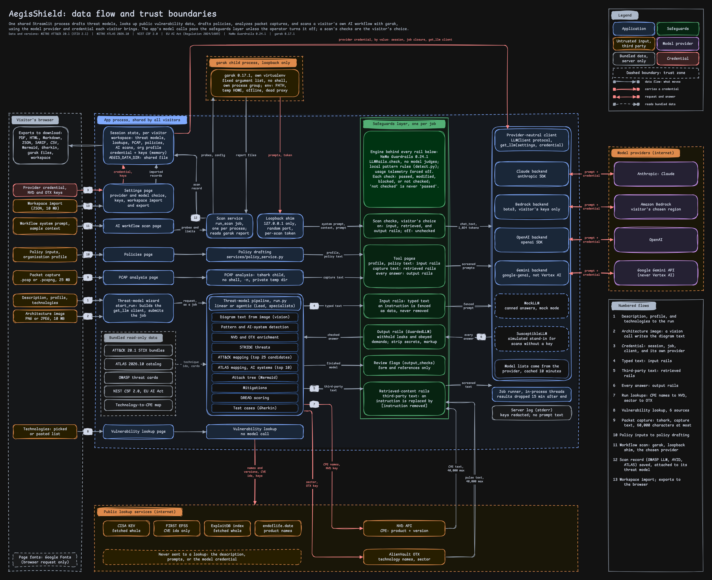

# Data-flow diagram

`aegisshield-dataflow.excalidraw` is the source. It is drawn in Excalidraw's hand-drawn style: the code font (Comic Shanns) for all text and sloppiness 2 on every element. `aegisshield-dataflow.svg` and `aegisshield-dataflow.png` are the dark-theme export, the primary one; `aegisshield-dataflow-light.svg` and `aegisshield-dataflow-light.png` are the light-theme export of the same scene. Both PNGs are 3200 pixels wide, and both SVGs embed the font they use.

## Reading the diagram

The columns run left to right: the visitor's browser, the Streamlit pages, the services and the threat-model pipeline, the safeguards layer, the provider-neutral model client, and the model providers. Each safeguard box sits on the row whose traffic it screens, under NeMo Guardrails, the engine that runs every rail. Each provider backend in the client lines up with its provider. Public lookup services run along the bottom, the garak child process sits above the scan service, and the legend and the numbered flows fill the right-hand column.

### Colors and lines

| Mark | Meaning |
|---|---|
| Blue box | Application code in the app process |
| Green box | Safeguards: NeMo Guardrails rails and the review flags |
| Amber box | Untrusted input from the visitor, or a third-party program or service |
| Purple box | A model provider |
| Gray box | Bundled read-only data, or server-only output |
| Small dark tab with a number | The start of a numbered flow |
| Red box or arrow | A credential, or a flow that carries one |
| Double-headed red arrow | A request with the credential to a provider, and its answer back |
| Dashed blue box | An in-process model double (MockLLM, the simulated stand-in) |
| Dashed rectangle | A trust boundary |
| Dashed gray arrow | A read of bundled data |

In the dark export Excalidraw's own dark theme shifts every color, so the same roles read as lighter strokes on dark fills.

### Trust boundaries

- **Visitor's browser.** Everything typed or uploaded here is untrusted. The page's own fonts come from Google Fonts; that request is the browser's, and carries no app data.
- **App process.** One Streamlit process serves every anonymous visitor. Each visitor's workspace, provider credential, and NVD and OTX keys live in their own session state. Jobs run on in-process threads; there is no database and no separate worker.
- **Bundled read-only data.** ATT&CK 20.1 STIX bundles, the ATLAS 2026.10 catalog, the OWASP threat cards, NIST CSF 2.0 and the EU AI Act obligations, and the technology-to-CPE map, read from the image.
- **garak child process.** garak 0.17.1 runs from its own virtualenv with a fixed argument list, no shell, its own process group, and a minimal environment whose proxy points every outside address at a closed port. Its only address is the loopback shim on 127.0.0.1.
- **Third-party services on the internet.** The four model providers, and the public lookups (NVD, AlienVault OTX, FIRST EPSS, CISA KEV, the ExploitDB index, and endoflife.date).

### Numbered flows

1. **Threat-model request.** The description, application profile, and technologies go from the wizard to the pipeline as a job.
2. **Architecture image.** The pipeline asks the chosen model to describe the image; the description is treated as third-party text.
3. **Credential.** The visitor types a provider credential (and optional NVD and OTX keys) on Settings. It is kept in session state, passed by value into the job's closure and the `get_llm` client, and sent only to its own provider. It never reaches a log, the workspace, an export, or garak.
4. **Typed text.** The description and profile values pass the input rails, which fence an instruction as data and never remove it.
5. **Third-party text.** Diagram text, an imported record, the lookup hand-off sentence, and NVD and OTX results pass the retrieved-content rails, which replace an instruction with "[instruction removed]".
6. **Answers.** Every model answer passes the output rails, which withhold an answer that leaks the step's instructions or obeys a typed demand, and strip key-shaped secrets and remote markup. The finished threat model gets review flags for form and references.
7. **Run lookups.** The pipeline sends CPE names (product and version) with the NVD key to NVD, and the industry sector with the OTX key to OTX. Their text is capped at 40,000 characters and screened before it reaches a prompt.
8. **Vulnerability lookup.** The lookup page sends product names and versions to NVD, technology names to endoflife.date and OTX, and CVE ids to EPSS. The KEV catalog and the ExploitDB index are downloaded whole, so nothing about the request is sent for them. No model is called.
9. **Packet capture.** `tshark` reads the upload in a private temporary directory with no shell and no name resolution. Only the extracted text, at most 60,000 characters, goes to the model, through the retrieved-content rails.
10. **Policies.** The organization profile and policy text pass the input rails before policy drafting.
11. **AI workflow scan.** The scan service starts garak, which sends its attack prompts with a per-scan bearer token to the loopback shim. The shim makes each prompt one call with the visitor's system prompt and sample context to the chosen provider, through the safeguards when the visitor turns them on.
12. **Scan record.** The service reads garak's report and saves the counts with OWASP LLM, AVID, and the app's ATLAS references to the workspace, attached to the threat model the scan was started from.
13. **Workspace and exports.** A workspace import enters through Settings. Exports go back to the browser: PDF, HTML, Markdown, JSON, SARIF, CSV, the Mermaid attack tree, Gherkin test cases, garak's files, and the workspace JSON.

Not drawn: the threat-model detail and dashboard pages, the NIST CSF and EU AI Act views (data-only mappings with no model call), and the developer-only scan surfaces.

## Editing and re-exporting

1. Open [excalidraw.com](https://excalidraw.com) and load `aegisshield-dataflow.excalidraw` (menu, Open). Labels are bound to their boxes and arrows to their ends, so a box can be dragged and its arrows follow. Each zone is a group; double-click into a group to move one box.
2. Arrows with corners are Excalidraw elbow arrows whose middle segments are pinned, so the app keeps their lanes when a box moves. Straight arrows are plain arrows. Arrow labels carry their position along the arrow.
3. Keep the conventions: the code font, sloppiness 2, the three text sizes (40, 18, and 14), and the colors in the table above. Labels and the flow-number tabs are sized for the code font with room to spare; a wider font may need wider tabs.
4. Save the scene back to this file (menu, Save to, Disk). Keep the file's `"source"` value as `https://excalidraw.com`, since the site writes the address it was served from. Then export PNG and SVG twice, in dark and light theme (menu, Export image; turn off "Embed scene"), and replace the four image files.

Verified against Excalidraw `@excalidraw/excalidraw` 0.18.0-c0a0ca3, the current snapshot of the code excalidraw.com runs, and against 0.18.1, the latest npm release. The committed images were exported offline through the snapshot's own restore and export code in headless Chromium, with every request outside a local file server blocked, then rasterized at 3200 pixels wide. In both versions, in light and dark theme, and with the scene restyled (sloppiness 1), every arrow kept its corners, no text wrapped, nothing overlapped, and a save-and-reopen round trip exported the same image. Loading the scene in the snapshot's editor, restyling everything, and moving the boxes the arrows attach to also kept every corner.
