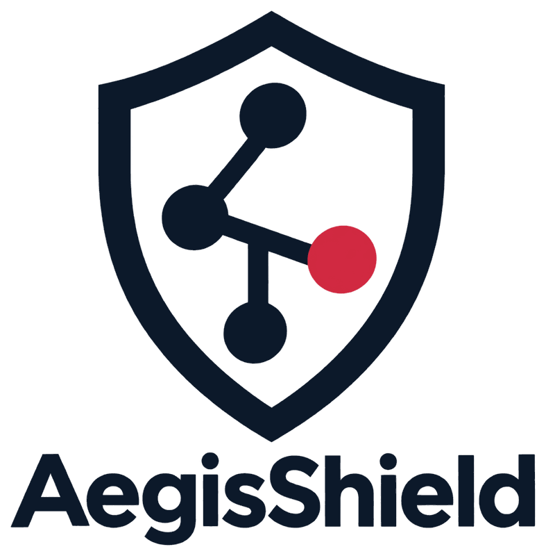
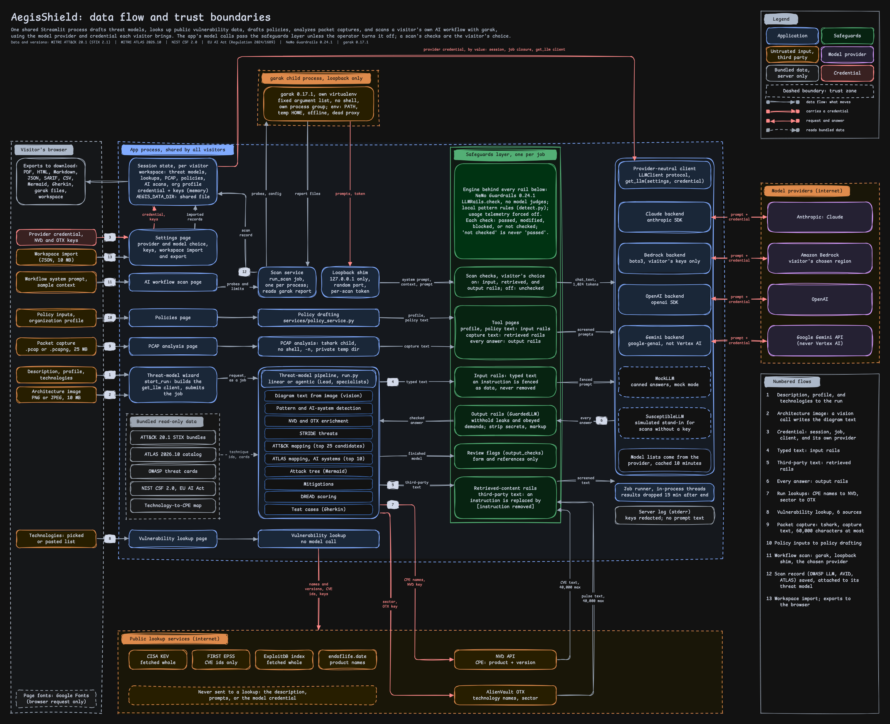
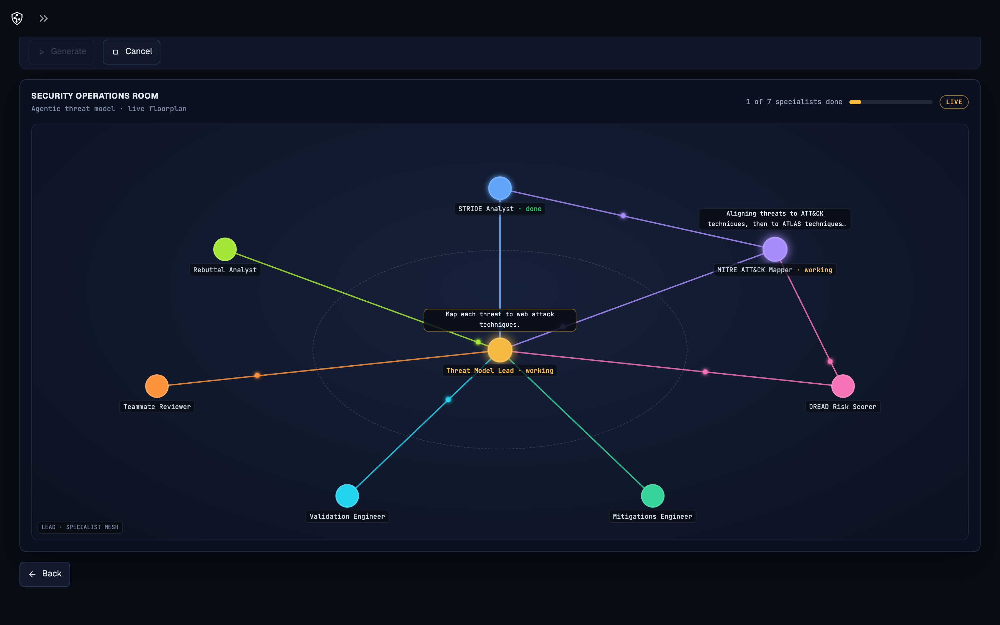
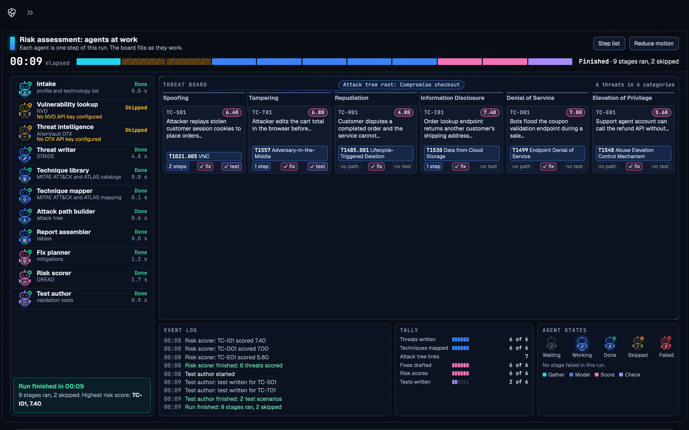
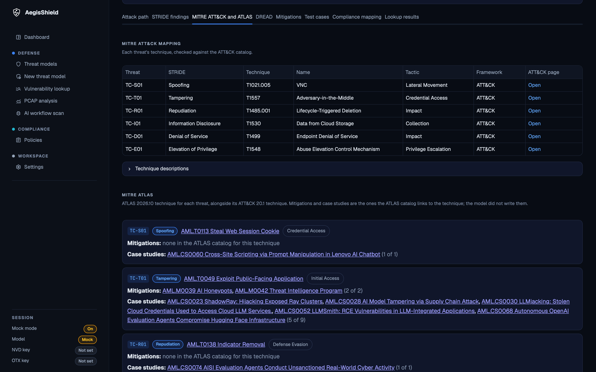
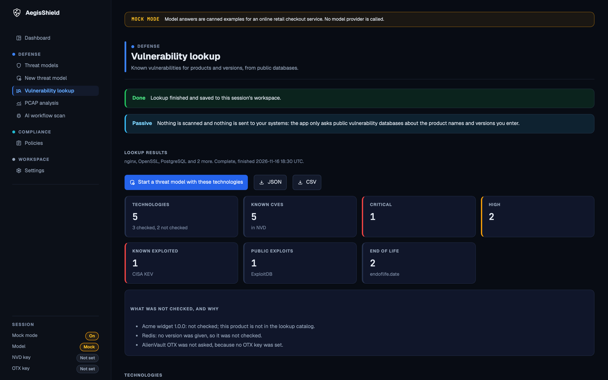
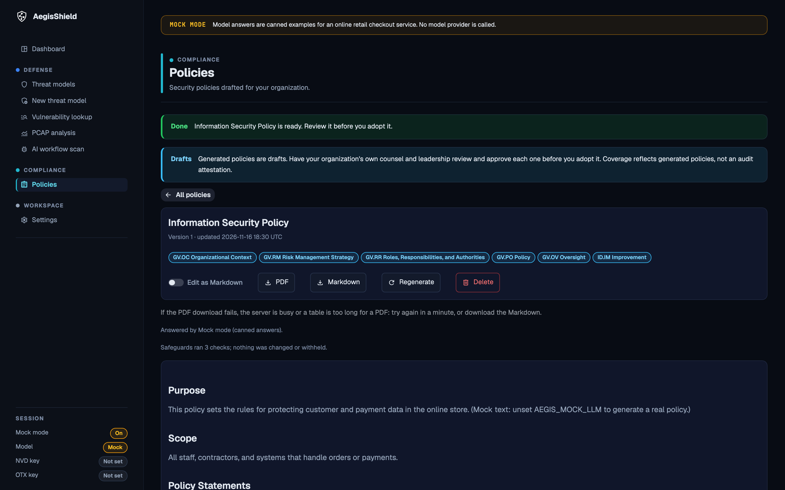
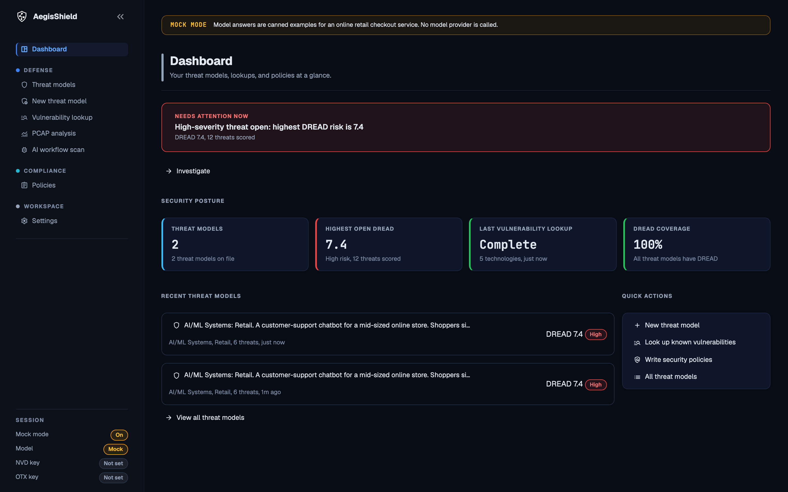

<p align="center">
  <picture>
    <source media="(prefers-color-scheme: dark)" srcset="aegisshield/ui/assets/brand/logo-dark.png">
    <source media="(prefers-color-scheme: light)" srcset="aegisshield/ui/assets/brand/logo-light.png">
    
  </picture>
</p>

[](https://www.gnu.org/licenses/agpl-3.0)
[](https://www.python.org/downloads/)
[](https://codecov.io/gh/mgrofsky/AegisShield)

### Coverage Overview
[](https://codecov.io/gh/mgrofsky/AegisShield)

# AegisShield

AegisShield is a Streamlit app that drafts a threat model for a system you describe. A language model writes STRIDE threats and maps them to MITRE ATT&CK, scores them with DREAD, and drafts mitigations and test cases, while the page shows each step as it runs. It also looks up known vulnerabilities for products you name in public databases, drafts security policies, and summarizes packet captures.

Everything it writes is a draft for a person to review. It was built for research into making threat modeling easier to start (see [Research](#research)).

## Contents

- [How it works](#how-it-works)
- [What it does](#what-it-does)
- [What it does not do](#what-it-does-not-do)
- [Run it](#run-it)
- [Configuration](#configuration)
- [Try it without a key: mock mode](#try-it-without-a-key-mock-mode)
- [Data handling and privacy](#data-handling-and-privacy)
- [Project layout](#project-layout)
- [Development](#development)
- [Security and NIST SP 800-53](#security-and-nist-sp-800-53)
- [Responsible use](#responsible-use)
- [Research](#research)
- [License, citation, and acknowledgements](#license-citation-and-acknowledgements)

## How it works



One Streamlit process serves every visitor, and each visitor brings their own model provider credential. Read the diagram left to right: the visitor's browser, the app's pages, the services and the threat-model pipeline, the safeguards layer that every model call passes through, the provider-neutral model client, and the four model providers, with the public lookup services along the bottom. Dashed rectangles are the trust zones, and red boxes and arrows mark a credential and the flows that carry one. [docs/diagrams/README.md](docs/diagrams/README.md) has the legend and the numbered flows; the diagram is also available as [SVG](docs/diagrams/aegisshield-dataflow.svg) and as editable [Excalidraw source](docs/diagrams/aegisshield-dataflow.excalidraw). [docs/architecture.md](docs/architecture.md) explains how the code fits together.

## What it does

### Threat-model wizard

You describe the application, optionally upload an architecture diagram for the model to describe, and pick its type, industry, data sensitivity, exposure, compliance requirements, authentication methods, and technologies with versions. Then you generate.

A run takes one of two paths:

- **Linear** (default): one stage after another. The live view is a board of agents at work: each stage as it starts and finishes, threats appearing as they are written, then each threat's technique, attack path, fix, risk score, and test.
- **Agentic**: a lead plans the work and hands it to specialists (STRIDE, ATT&CK mapping, DREAD, mitigations, test cases, a teammate reviewer, and a rebuttal analyst). The live view is a floor plan of the specialists and what each is doing. Turn it on under Settings. If the operator sets `AEGIS_AGENTIC`, every run is agentic and the Settings switch shows on and cannot be turned off.





A finished threat model includes:

- STRIDE threats, each with a scenario, assumptions, and potential impact.
- MITRE ATT&CK techniques for each threat, checked against the ATT&CK catalog in `MITRE_ATTACK_DATA/`.
- For an AI system (an AI or machine learning application type, or any AI pattern you select or the app detects in the description): the prompts also draw on the OWASP reference cards and a MITRE ATLAS card, and each threat also gets a MITRE ATLAS technique, picked in one extra model call from ATLAS candidates and checked against the bundled ATLAS catalog (or none, when none fits), with the ATLAS mitigations and case studies the catalog links to it. The model does not write those mitigations and case studies; they come from the catalog.
- An attack tree (Mermaid).
- Optional add-ons, on by default: mitigations, a DREAD risk assessment, and Gherkin test cases.
- A NIST CSF 2.0 view: which CSF functions and categories each threat touches, from its STRIDE category and its ATT&CK tactic. This is a fixed mapping in `aegisshield/data/nist/csf-2.0.json`; no model is involved.
- An EU AI Act view, shown when the application is an AI system or you selected the EU AI Act: obligations whose wording overlaps each threat, by keyword match.
- If you set the keys: NVD vulnerabilities for the selected technologies and versions, and recent AlienVault OTX reports for the industry sector.
- Improvement suggestions for the description.

Downloads: a PDF report, a self-contained HTML report, JSON, SARIF 2.1.0 (for code-scanning tools), Markdown, the attack tree as a `.mmd` file, and the test cases as a `.feature` file.



### Vulnerability lookup

Paste or pick products and versions (for example `nginx 1.25.3`). For each one with a version and a known product, the app asks public sources what is known:

- **NVD**: CVEs listed for that product at that version. Works without a key, more slowly.
- **CISA KEV**: whether a CVE is known to be exploited.
- **FIRST EPSS**: exploit prediction scores.
- **ExploitDB**: public exploit references.
- **endoflife.date**: whether the release is still supported.
- **AlienVault OTX**: community reports, with an OTX key.

It says what it did not check and why. At most 30 technologies per request and 15 lookups per job, within a five-minute budget. A finished lookup can start a threat model with the same technologies, and downloads as JSON or CSV.



### Policies

Fill in an organization profile once, then draft any of nine security policies from a catalog. Each draft is tagged with the NIST CSF 2.0 categories it covers, can be edited as Markdown, and downloads as PDF or Markdown. Policies are drafts: have your own counsel and leadership review them before adopting one.



### PCAP analysis

Upload a `.pcap` or `.pcapng` file of up to 25 MB. `tshark` summarizes it on the server (protocols, conversations, DNS, TLS server names, HTTP, SIP, and RTP), and the model analyzes the summary. The raw capture is never sent to the model. A capture that ends in the middle of a packet is analyzed up to that point, and the page says so. On Linux with `prlimit` installed, each `tshark` call is limited to 3 GiB of address space and 90 seconds of CPU; elsewhere it runs without those limits. This page appears only when `tshark` is installed.

### AI safeguards and workflow scans

Every model call passes NeMo Guardrails rails that look for instructions hidden in the text the app sends (typed text is fenced as data; text from lookups, captures, diagrams, and imports has the instruction removed) and check every answer (an answer that repeats the app's own instructions or obeys a hidden one is withheld; key-shaped secrets and markup that would send data to another host are removed). Plain-code checks then flag threat-model references that do not resolve, as "Review flags". A results view shows a Safeguards block and a Review flags block, and Settings shows whether the safeguards are on. The rails are pattern rules that can be phrased around, and they have been measured only against a simulated model. With `AEGIS_AI_SCAN` set and garak installed in its own environment from `requirements-aiscan.txt`, an "AI workflow scan" page runs NVIDIA garak against your own AI workflow: a system prompt you give and the provider and model you chose in Settings, through the app's own client, with the app's checks on or off. See [docs/ai-safeguards.md](docs/ai-safeguards.md) for how they work, what was measured, and their limits.

### Dashboard and settings

The dashboard shows your saved threat models, the highest open DREAD risk, and your latest lookup. Settings holds your model provider, its credential, and the model you pick from that provider's own list, your lookup keys for this session, the agentic switch, and the workspace: export it as JSON, import it later, or clear it.



## What it does not do

- **No scanning of other systems.** It never probes, connects to, or sends traffic to a system you describe or look up. The vulnerability lookup asks public databases about product names and versions; `tshark` reads only the file you upload. The optional AI workflow scan is different: it sends garak's prompts, through a loopback endpoint the app starts for the scan, to the model you chose in Settings, through your chosen provider, with a system prompt you give, and never contacts an address a visitor gives it. It does not test your deployed system.
- **No proof of safety.** The safeguards and scans say what they checked and what they found. They do not make the app or its output secure, and a clean scan is not evidence of resistance.
- **No accounts.** There is no sign-in, no users, and no access control. Anyone who can reach a deployment can use it (see [SECURITY.md](SECURITY.md) before deploying for others).
- **No database.** Your work lives in your browser session unless you export it.
- **No guarantee of correctness.** Threat models, policies, compliance mappings, and analyses are written by a language model and must be reviewed by a person.

## Run it

You need Python 3.13. `requirements.txt` pins every package the app imports directly to the version the tests run against, including NeMo Guardrails (0.24.1) for the safeguards and the Anthropic (2.8.0), boto3 (1.44.3), and google-genai (3.3.0) SDKs for the Claude, Bedrock, and Gemini providers; those three SDKs, with what they bring, take about 51 MB of installed files in a macOS virtual environment. Each SDK is imported only when its provider is used, so the app starts without one and shows that provider as not installed. garak, for the optional AI workflow scan, goes in its own environment (`requirements-aiscan.txt`; see [docs/ai-safeguards.md](docs/ai-safeguards.md#setup)), never the app's. `tshark` is optional and enables the PCAP page; it is the only system package the app uses (`packages.txt`, CI, and the `Dockerfile` install only `tshark`, plus `curl` in the image for the health check).

### Locally

```sh
python3.13 -m venv .venv
source .venv/bin/activate
pip install -r requirements.txt
streamlit run main.py
```

Open http://localhost:8501, choose a model provider under Settings, enter its credential, and pick a model (see [Model providers](#model-providers)). To look around without a key, see [mock mode](#try-it-without-a-key-mock-mode).

### Docker

```sh
docker build -t aegisshield .
docker run --rm -p 8501:8501 aegisshield
```

The image starts from `python:3.13-slim` pinned by digest, includes `tshark` and `prlimit`, has no compiler, installs Python packages from prebuilt wheels only (`pip install --only-binary=:all:`), and runs as an unprivileged user (uid 10001) that can read the app tree but not change it. It holds only what the app needs at run time (`.dockerignore`): no tests, tools, or research material. Docker checks `/_stcore/health` for its health status. Pass settings with `-e`, for example `-e AEGIS_MOCK_LLM=1`. The image contains no secrets file, so visitors enter their own keys. If you set `AEGIS_DATA_DIR`, it must be a directory that uid 10001 can write.

### Streamlit Community Cloud

Point a new app at this repository with `main.py` as the main file and Python 3.13. `requirements.txt` lists the Python packages and `packages.txt` the one system package, `tshark`. Put operator keys in the app's secrets (see below). The app has no sign-in, so a public app can be used by anyone; read [SECURITY.md](SECURITY.md) first.

## Configuration

### Environment variables

These are all the environment variables the app reads (`aegisshield/config.py`, `aegisshield/services/lookup_switches.py`). Switches are on when set to `1`, `true`, `yes`, or `on`.

| Variable | Default | What it does |
|----------|---------|--------------|
| `AEGIS_MOCK_LLM` | off | Use canned model answers instead of a model provider. No key needed. See [mock mode](#try-it-without-a-key-mock-mode). |
| `AEGIS_OFFLINE` | off | Turns off every outside lookup, in vulnerability lookups and in threat-model runs. A switched-off source shows as skipped. |
| `AEGIS_DISABLE_NVD`, `AEGIS_DISABLE_KEV`, `AEGIS_DISABLE_EPSS`, `AEGIS_DISABLE_EXPLOITDB`, `AEGIS_DISABLE_EOL`, `AEGIS_DISABLE_OTX` | off | Each turns off one source wherever it is used. A threat-model run uses only NVD and OTX; the vulnerability lookup uses all six. A switched-off source shows as skipped. |
| `AEGIS_AGENTIC` | off | Every threat-model run takes the agentic path. The Settings switch then shows on and cannot be turned off. |
| `AEGIS_PROVIDERS` | all four | A comma-separated subset of `claude,bedrock,openai,gemini`: the model providers visitors may choose. Unknown names are ignored; a value that names none of the four offers all four. No operator setting holds a provider credential. |
| `AEGIS_ARCHITECT_MODEL`, `AEGIS_WORKER_MODEL` | `gpt-5.4` | For OpenAI only: the model preselected when OpenAI's own list holds it. Only names in `AVAILABLE_MODELS` in `aegisshield/config.py` are accepted (currently `gpt-5.4`); anything else is ignored with a warning in the log. Whatever model a visitor picks answers every call of their session. |
| `AEGIS_DATA_DIR` | unset | Keep the workspace in `workspace.json` in this directory instead of the browser session. That one file is shared by everyone who can open the app (the Settings page says so, and the app logs a warning at start-up), so set it only for a single-user install. In the Docker image it must be writable by uid 10001. |
| `AEGIS_MAX_CONCURRENT_JOBS` | `4` | Jobs (threat models, lookups, policies, PCAP analyses) that may run at once in the whole process. Separately, at most 1 capture analysis, 2 vulnerability lookups, 2 policies, 3 threat models, and 1 AI workflow scan run at once (`DEFAULT_JOB_KIND_LIMITS` in `aegisshield/config.py`; no environment variable). A refused job gets "Too many tasks are running on this server right now." |
| `AEGIS_JOB_TIMEOUT_SECONDS` | `1800` | A job still running after this many seconds is marked failed and told to stop. |
| `AEGIS_SAFEGUARDS` | on | Set to `0`, `false`, `no`, or `off` to turn the model-call safeguards off for the whole deployment. Visitors cannot turn them off. |
| `AEGIS_SAFEGUARDS_STRICT` | off | A check of input or retrieved text that could not run stops the step instead of letting it go on marked "not fully checked". An answer that could not be checked is withheld either way. |
| `AEGIS_AI_SCAN` | off | Offer the "AI workflow scan" page. It appears only when `AEGIS_GARAK_PYTHON` also names a working garak environment. |
| `AEGIS_GARAK_PYTHON` | unset | Absolute path of the Python interpreter in the separate garak environment. |

The app also sets `NEMO_GUARDRAILS_NO_USAGE_STATS=1` itself, overriding any value, so NeMo never sends usage statistics.

Development tools and tests read a few more:

- `AEGIS_REGEN_FIXTURES=1` regenerates the pipeline frame fixture (`tests/aegisshield/pipeline/test_pipeline_frames.py`), and `AEGIS_SKIP_SLOW=1` skips one slow safeguards test.
- The browser check's entry points, `tools/mock_entry.py` and `tools/provider_entry.py`, read `CHECK_NVD_DELAY` and `AEGIS_GARAK_PYTHON` (a fake garak is used when it is unset); `tools/mock_entry.py` also reads `CHECK_REAL_TSHARK` and `CHECK_GARAK_DELAY`.
- `tools/garak_offon.py` needs `AEGIS_GARAK_PYTHON`; `tools/safeguard_eval.py` reads it to record garak's version, and with `--real` reads `OPENAI_API_KEY`.
- `tools/provider_smoke.py --real` reads `AEGIS_SMOKE_<PROVIDER>_API_KEY` (for Bedrock also `AEGIS_SMOKE_BEDROCK_REGION`) and an optional `AEGIS_SMOKE_<PROVIDER>_MODEL`.

Streamlit also reads its own `STREAMLIT_*` variables.

### Keys

Each visitor enters their own keys under Settings. They are kept for that browser session only.

- **A model provider credential**: needed for every model step, unless mock mode is on (see [Model providers](#model-providers)). There is no operator setting for it.
- **NVD**: optional. Lookups work without it, more slowly; a threat-model run skips its NVD step without it.
- **AlienVault OTX**: optional. Without it, OTX is skipped.

An operator can provide NVD and OTX keys for every visitor in `.streamlit/secrets.toml` (git ignores this file). A visitor's own key takes precedence.

```toml
nvd_api_key = "..."
alienvault_api_key = "..."
```

### Model providers

A visitor chooses one of four providers under Settings, enters that provider's credential, and picks a model from the list the provider returns for that credential. The chosen model answers every model call of the session: threat models (both paths), the diagram description, policies, capture analyses, and AI workflow scans run with a real model. Each saved result records which provider and model answered; items saved before this change say it was not recorded.

| Provider | Credential | Models offered |
|----------|------------|----------------|
| Claude (Anthropic) | An Anthropic API key. | Every model the Models API lists for the key, except retired ones. `claude-opus-5-5` is preselected when listed. Whether a model reads images comes from its listed `image_input` capability. |
| Amazon Bedrock | A region from a fixed list, and either a Bedrock API key or an AWS access key ID, secret access key, and optional session token. When both are held, the API key is used. | Foundation models in that region that take text in, give text out (not embeddings), stream, are active, and can be called on demand, plus active inference profiles whose every model passes the same tests. Bedrock's list does not say which models its Converse API serves; a model it does not serve fails with a fixed sentence. Image support comes from each model's listed input types. No model is preselected. |
| OpenAI | An OpenAI API key. | Chat models only: ids that start with `gpt-`, `chatgpt-`, or `o` and a digit, without a part naming another kind of model or API (audio, realtime, transcribe, tts, image, embedding, moderation, search, instruct, codex, pro, deep, research). `gpt-5.4` (or `AEGIS_ARCHITECT_MODEL`) is preselected when listed. |
| Gemini (Google) | A Gemini API key. | Models whose listing says they support content generation. No model is preselected. |

- **The credential stays in the session.** It is typed into masked fields, kept only in the browser session's server-side state, passed by value to the client that needs it, and never written to the workspace, an export, a file, a log line, or a URL. It is gone when the session ends.
- **Bedrock uses only the visitor's credential.** The app builds the AWS session from the values the visitor typed and nothing else: no profile, no shared config or credentials file, no AWS environment variable (a server-side `AWS_PROFILE`, access key, session token, Bedrock bearer token, or endpoint URL is ignored), no instance role, and no default credential chain. A Bedrock API key is sent as the bearer token of each request to Bedrock in the chosen region; access keys sign each request instead.
- **Bedrock API keys.** AWS issues two kinds. A short-term key lasts at most 12 hours (less if the session that made it ends sooner) and works only in the region where it was made; a long-term key lasts until the date set when it was made. Bedrock accepts API keys in fewer regions than access keys, and a key can list models only if the identity behind it is allowed to; either way, a refused listing shows the usual fixed sentence. The key is a secret like the others: masked, kept in the session only, and removed from log lines by its documented shape.
- **Lists are live, never hardcoded.** The app asks the provider for its models when a credential is entered, keeps the list in the session for 10 minutes, and asks again on **Refresh list**. Each list is cut to 200 models, each id to 128 characters of letters, digits, dots, underscores, colons, and hyphens; anything else is dropped before it is shown or used. A model not on the provider's latest list is refused in code. A list that fails shows one fixed sentence, never the provider's own text.
- **Images.** When the provider's list says a model takes no images, the diagram is not sent and the page says so. When the list says nothing, the image is tried; a refusal shows one fixed sentence and the run goes on without the diagram text.
- **Missing pieces.** A step started without a complete credential or a chosen model is refused with one sentence naming what is missing. A provider whose software is not installed on the server is marked "not installed" and cannot be used.
- **Tests use fakes.** The test suite runs each backend against fakes that use its SDK's real response shapes (Anthropic 2.8.0, boto3 1.44.3, google-genai 3.3.0, and the OpenAI SDK), never a real provider; `tools/provider_smoke.py` (see [Development](#development)) checks one real provider by hand.

`.streamlit/config.toml` holds the theme and hides Streamlit's developer menu and error details from visitors; it contains no keys.

## Try it without a key: mock mode

Mock mode replaces the model with canned answers about an online retail checkout service, so you can see every page without a provider credential. The Settings page says mock mode is on, and its provider and model controls are disabled. It does not stop outside lookups, so add `AEGIS_OFFLINE=1` if you want none of those either.

```sh
AEGIS_MOCK_LLM=1 AEGIS_OFFLINE=1 streamlit run main.py
```

1. A banner at the top says mock mode is on. On the dashboard, **Try with sample data** adds a finished threat model (this button appears only in mock mode).
2. Open **New threat model**, choose **Insert the example description**, fill in the profile, and generate. The live board fills in over a few seconds.
3. Under **Settings**, turn on **Agentic threat modeling** and generate again to see the floor plan.
4. Open the saved threat model from **Threat models** to see its sections and downloads.
5. Under **Policies**, fill in the organization profile and draft a policy from the catalog.
6. With `tshark` installed, upload a capture under **PCAP analysis**.
7. Under **Settings**, the Safeguards section says whether the safeguards are on. A finished threat model shows a Safeguards block and a Review flags block.
8. With `AEGIS_AI_SCAN=1` and `AEGIS_GARAK_PYTHON` set to a garak environment's Python, open **AI workflow scan**, enter a system prompt, pick probes, and run a scan. In mock mode it uses the simulated stand-in model, and the results say so.

With `AEGIS_OFFLINE=1` the vulnerability lookup runs but reports each technology as not checked, because lookups are switched off, and a threat-model run shows its NVD and OTX steps as skipped. Without it, lookups reach the real public sources even in mock mode.

## Data handling and privacy

- **Keys and the provider credential** stay in your browser session's server-side state. They are never written to the workspace, an export, a file, a log line, or a URL, and each goes only to its own service.
- **Your work** (threat models, lookups, policies, PCAP analyses, AI workflow scans, the organization profile) is kept in your session and is gone when the session ends, unless you export it from Settings or the operator set `AEGIS_DATA_DIR`.
- **Job results** are held in the server's memory and dropped 15 minutes after the job finishes. While a job runs, its id is in the page URL (`?run=`) so a reload can find it; anyone with that URL can open the job while it runs and for 30 seconds after it ends, and the page removes the id when the job ends.
- **Limits.** The server accepts at most 25 MB per upload (packet captures 25 MB, workspace imports 10 MB, architecture diagrams 10 MB, each checked on the server), and enforces text limits: description 20,000 characters, diagram description 10,000, policy text 100,000, version strings 32, profile values 200 characters and 500 items.
- **Links and PDFs.** In the HTML export and the PDFs, links stay links only for http, https, mailto, and in-page fragments; in the page, model text that names a `javascript:`, `vbscript:`, `data:`, or `file:` scheme shows all its links as plain text. PDFs (the report and policies) load nothing over the network and read no local file; only images embedded in them load.
- **What is sent where, and when:**

| Service | When | What |
|---------|------|------|
| The model provider you choose (Anthropic, Amazon Bedrock in your chosen region, OpenAI, or Google's Gemini API) | Each model step of a threat model, policy, diagram description, or PCAP analysis, each prompt of an AI workflow scan you run with a real model, and each model list the Settings page asks for. Never in mock mode. | Your description, profile, and selections; the diagram image; the organization profile; the PCAP summary (never the capture); garak's attack prompts as the user's message, with the system prompt and sample context you give for a scan. |
| NeMo Guardrails | Never. It runs inside the app with no model and its usage statistics off. | Nothing. |
| garak | Never outside the server. It talks only to a loopback endpoint the app starts for the scan. | Nothing. |
| NVD | Vulnerability lookups; threat-model runs when an NVD key is set. | Product names and versions as CPE names. |
| AlienVault OTX | Threat-model runs and lookups, only with an OTX key. | The industry sector (threat models) or technology names (lookups). |
| CISA KEV, ExploitDB | Vulnerability lookups. | Nothing about you: the KEV catalog and the ExploitDB index are downloaded whole. |
| FIRST EPSS | Vulnerability lookups. | CVE ids. |
| endoflife.date | Vulnerability lookups. | Product names. |
| Google Fonts | When a page loads, from your browser. | A normal font request. |

`AEGIS_OFFLINE` and the `AEGIS_DISABLE_*` switches turn off the lookup rows as described under [Configuration](#configuration). OTX requests time out after 10 seconds to connect and 20 seconds to read, on top of the OTX client's own retries. Streamlit itself, when started headless without a specific server address (as in the Docker image), looks up the server's public IP address at `checkip.amazonaws.com` to print an "External URL"; set `logger.hideWelcomeMessage` or `browser.serverAddress` to avoid that.

Do not submit secrets or data your organization has not approved for these services.

## Project layout

```
main.py                  entry point: streamlit run main.py
aegisshield/
  ui/                    pages, navigation, session state, widgets, live-view components (the only package that imports Streamlit)
  ui/assets/brand/       the logo and shield, light and dark artwork, and the browser tab icon
  pipeline/              the threat-model run: linear and agentic paths, each stage, NVD and OTX steps, live progress record
  services/              vulnerability lookup and its sources, CSF and EU AI Act mapping, policies, PCAP, exports
  llm/                   model client protocol, the Claude, Bedrock, OpenAI, and Gemini clients, the providers and live model lists, mock client, simulated stand-in for tests and scans
  safeguards/            NeMo Guardrails rails and the checks on every model call
  aiscan/                AI workflow scans with garak (subprocess, loopback shim, report parser)
  jobs/                  in-process background job runner
  storage/               per-visitor workspace and its stores
  core/                  errors, retry, text sanitation, logging, the OTX client wrapper
  data/                  packaged reference data (ATLAS, NIST CSF 2.0, regulations, threat cards, CPE map)
MITRE_ATTACK_DATA/       ATT&CK bundles (enterprise, mobile, ICS)
tests/                   pytest suite
tools/                   browser check, fixture builders, safeguards evaluation and NeMo replay, garak off/on scans, provider check, MITRE data refresh
research/                the paper's case studies, batch inputs and outputs, notebook, and first-generation pipeline; not used by the app (see its README)
docs/                    architecture notes, the data-flow diagram, the safeguards page and its results, screenshots
```

[docs/architecture.md](docs/architecture.md) explains how the pieces fit together.

## Development

```sh
pip install -r requirements.txt -r requirements-dev.txt
python -m pytest -q
ruff check .
```

The tests make no network calls and need no keys. CI runs the same lint and tests on Python 3.13 (`.github/workflows/tests.yml`).

`tools/browser_check.py` drives the app in headless Chromium in mock mode, with the outside lookup sources stubbed, and checks every page, both live views, each kind of job, and the downloads:

```sh
python -m playwright install chromium
python tools/browser_check.py --only pages
```

Run it without `--only` for every check. Screenshots and readings go to `build/browser_check/`.

`tools/safeguard_eval.py` measures what the safeguards do on a fixed set of cases, and `tools/garak_offon.py` runs garak scans with them off and on; [docs/ai-safeguards.md](docs/ai-safeguards.md#running-the-evaluation-and-the-tests) says how to run both and what the committed results show.

`tools/provider_smoke.py` checks one real provider by hand: it lists the models and makes one call of at most 64 output tokens with the app's own client, and prints the provider, the model, and pass or fail, never the key. The call is billed by the provider, so it refuses to run without `--real`:

```bash
AEGIS_SMOKE_BEDROCK_API_KEY=... AEGIS_SMOKE_BEDROCK_REGION=us-east-1 python tools/provider_smoke.py --provider bedrock --real
```

Contributor notes: only `aegisshield/ui` imports Streamlit; services take the model client as an argument; model names come from `aegisshield/config.py`; keys are passed by value and never stored. If you change code named in [NIST-SP-800-53-CONTROLS.md](NIST-SP-800-53-CONTROLS.md), update it and its JSON together.

## Security and NIST SP 800-53

[SECURITY.md](SECURITY.md) covers reporting a vulnerability, how keys and uploads are handled, and what an operator must do before a public deployment.

[NIST-SP-800-53-CONTROLS.md](NIST-SP-800-53-CONTROLS.md) and [nist-sp-800-53-controls-mapping.json](nist-sp-800-53-controls-mapping.json) list where the code lines up with seven SP 800-53 Rev. 5 controls, with the functions and tests involved. They are the maintainers' description of the code, not an assessment, and not a statement of compliance.

## Responsible use

AegisShield is for defensive security work: threat modeling, risk reduction, and documentation.

Intended use:

- Threat identification using STRIDE
- Mitigation planning and risk assessment
- Security test-case drafting
- Drafting policies and supporting evidence for review

Prohibited use:

- Unauthorized access attempts
- Exploit or malware development
- Operational attack planning against real targets
- Instructions intended to evade lawful security controls

## Research

AegisShield was created as part of praxis research aimed at democratizing threat modeling. Its effectiveness was evaluated by comparing generated threat models against expert-developed models across 15 case studies drawn from published academic sources.

Everything for the paper is under [`research/`](research/), apart from the app; [research/README.md](research/README.md) indexes it and says what can be rerun from the repository alone and what cannot. None of it is needed to run the app.

- [`research/case_studies/`](research/case_studies/): the 15 case studies and the rubric used to evaluate them ([README](research/case_studies/README.md)).
- [`research/batch/inputs/`](research/batch/inputs/): one JSON input per case study, replicating what a user would enter in the app.
- [`research/batch/outputs/`](research/batch/outputs/): the generated results, one file per case study. Each holds 30 runs, and each run is a threat model of 18 threats (3 per STRIDE category) with assumptions, impact, and MITRE ATT&CK data: 450 threat models and 8,100 threats in all.
- [`research/batch/`](research/batch/): the first-generation batch pipeline (`research/batch/main-batch.py`). Its code was edited after the outputs were generated; [research/README.md](research/README.md) says how to run it and how it differs from the code that produced the published files.
- [`research/colab_notebook/`](research/colab_notebook/): the analysis notebook (readability, semantic similarity, ATT&CK mapping coverage, and exploratory statistics) ([README](research/colab_notebook/README.md)). It reads prepared data from a Google Drive folder that is not in the repository, so it cannot be rerun from the repository alone.

The app in `aegisshield/` is a later rewrite and is not the tool that produced these results.

## License, citation, and acknowledgements

Licensed under the GNU Affero General Public License v3.0 (AGPL-3.0). See [LICENSE](LICENSE).

To cite the software or its data, cite this repository: Matt Grofsky, AegisShield, https://github.com/mgrofsky/AegisShield.

Portions of code adapted from Matt Adams' [stride-gpt](https://github.com/mrwadams/stride-gpt) under MIT license.

This project is not affiliated with or endorsed by MITRE, OWASP, AlienVault, NIST, or any other organization mentioned.

The app bundles two MITRE data sets. Where each came from, its SHA-256, and how to refresh it are in [`MITRE_ATTACK_DATA/SOURCE.md`](MITRE_ATTACK_DATA/SOURCE.md) and [`aegisshield/data/atlas/SOURCE.md`](aegisshield/data/atlas/SOURCE.md); the Settings page shows both versions.

- MITRE ATT&CK® release 20.1, used under the [ATT&CK Terms of Use](https://attack.mitre.org/resources/legal-and-branding/terms-of-use/): "© 2026 The MITRE Corporation. This work is reproduced and distributed with the permission of The MITRE Corporation." MITRE grants a non-exclusive, royalty-free license to use ATT&CK for research, development, and commercial purposes, provided copies reproduce MITRE's copyright designation and the license.
- MITRE ATLAS™ release 2026.10, Copyright 2021-2026 MITRE, licensed under the [Apache License, Version 2.0](http://www.apache.org/licenses/LICENSE-2.0) (the `LICENSE` file of [mitre-atlas/atlas-data](https://github.com/mitre-atlas/atlas-data) and the [ATLAS Terms of Use](https://atlas.mitre.org/terms)). The app converts the release to JSON and keeps only the fields it uses.
- The threat cards in `aegisshield/data/threat_cards/` summarize material from the [OWASP GenAI Security Project](https://genai.owasp.org/) (the OWASP Top 10 for LLM Applications 2025 and the Agentic Security Initiative), licensed under [CC BY-SA 4.0](https://creativecommons.org/licenses/by-sa/4.0/); the summaries are shared under the same license. Sources and changes are in [`aegisshield/data/threat_cards/SOURCE.md`](aegisshield/data/threat_cards/SOURCE.md).
- `aegisshield/data/nist/csf-2.0.json` holds the functions and categories of the [NIST Cybersecurity Framework 2.0](https://www.nist.gov/cyberframework), a NIST publication, with the app's own STRIDE and ATT&CK tactic mapping to them.
- `aegisshield/data/regulations/eu-ai-act-2026-graph.json` summarizes obligations of [Regulation (EU) 2024/1689](https://eur-lex.europa.eu/eli/reg/2024/1689/oj), the EU AI Act, with the keywords the app matches on.

The app uses these projects without bundling them: [NVIDIA NeMo Guardrails](https://github.com/NVIDIA/NeMo-Guardrails) (Apache 2.0, installed from `requirements.txt`) runs the safeguards, and [NVIDIA garak](https://github.com/NVIDIA/garak) (Apache 2.0, installed in its own environment from `requirements-aiscan.txt`) runs the AI workflow scans. The Docker image installs Debian's `tshark` package from [Wireshark](https://www.wireshark.org/) (GPL-2.0 or later).

- MITRE ATT&CK® and ATT&CK® are registered trademarks of The MITRE Corporation
- AlienVault® is a registered trademark of 2024 LEVELBLUE, INC
- National Vulnerability Database (NVD) is a product of NIST
- NIST SP 800-53 Rev. 5 is a publication of the National Institute of Standards and Technology
